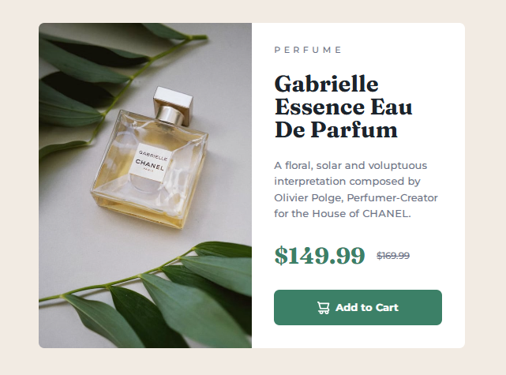

# Frontend Mentor - Product preview card component solution

This is a solution to the [Product preview card component challenge on Frontend Mentor](https://www.frontendmentor.io/challenges/product-preview-card-component-GO7UmttRfa). Frontend Mentor challenges help you improve your coding skills by building realistic projects.

## 📸 Screenshot

## 🔗 Links

- **Solution URL:** [View on Frontend Mentor](https://www.frontendmentor.io/profile/umidjonmurodullayev1997-creator)
- **Live Site URL:** [View Live Site](https://umidjonmurodullayev1997-creator.github.io/product-preview-card-component-main/)

---

## 🛠 Built with

- Semantic HTML5 markup
- CSS custom properties & Flexbox
- **Sass (SCSS)** preprocessor with nesting architecture & custom `rem()` function (`sass:math`)
- Mobile-first workflow & Responsive Media Queries
- Responsive `<picture>` element & smooth hover transitions

---

## 💡 What I Learned & Key Takeaways

Working on this project helped me solidify several core frontend concepts:

1. **Container & Card Sizing:** Combining `max-width` with `min-height: 100vh` and centering the card with `margin: 0 auto` to keep the layout balanced across screen sizes without horizontal overflow.
2. **Responsive Images with `<picture>`:** Switching cleanly between mobile and desktop product photos using `<picture>` and `<source media="(min-width: 768px)">` alongside `object-fit: cover` so proportions stay intact.
3. **Sass Nesting & `rem()` Conversion:** Structuring component styles cleanly with nested `@media` rules and converting pixel values into `rem` units via a custom function.
4. **Accessible Markup & Button States:** Using `alt=""` and `aria-hidden="true"` on the decorative cart icon, `type="button"` on the button, and smooth hover color transitions.

---

## 👨‍💻 Author

- **GitHub:** [@umidjonmurodullayev1997-creator](https://github.com/umidjonmurodullayev1997-creator)
- **Frontend Mentor:** [@umidjonmurodullayev1997-creator](https://www.frontendmentor.io/profile/umidjonmurodullayev1997-creator)
